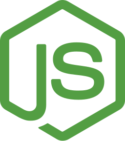
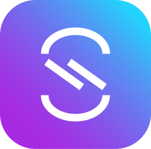
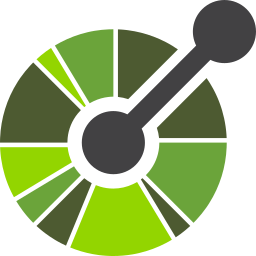
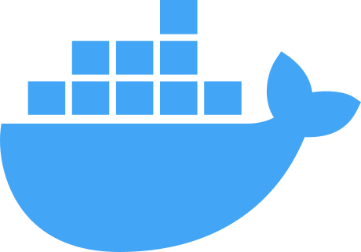
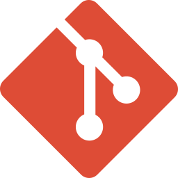

# jose-marti-analyzer-WikiAgora

<div align="center">


[](https://github.com/org/OperationCaribbeanSummer)


[](https://GitHub.com/OperationCaribbeanSummer/jose-marti-analyzer-WikiAgora/graphs/commit-activity)
[](https://github.com/OperationCaribbeanSummer/jose-marti-analyzer-WikiAgora/actions/workflows/test.yml)

<!-- Development Standards -->

[](https://makeapullrequest.com)
[](https://github.com/googleapis/release-please-action)
[](https://standardjs.com)
[](https://github.com/conventional-changelog/commitlint/tree/master/@commitlint/config-conventional)
[](http://commitizen.github.io/cz-cli)
[](https://editorconfig.org)
[](https://docs.github.com/en/get-started/using-github/github-flow)
[](https://VitePress.dev)
[](https://github.com/OAI/OpenAPI-Specification)
[](https://www.asyncapi.com)
[](https://semver.org)

[](https://github.com/OperationCaribbeanSummer/jose-marti-analyzer-WikiAgora/blob/main/LICENSE)
[](https://github.com/OperationCaribbeanSummer/jose-marti-analyzer-WikiAgora/blob/main/LICENSE-CONTENT)

<!-- useful urls -->

[website](https://OperationCaribbeanSummer.org) |
[Roadmap](ROADMAP.md) |
[Contribute](CONTRIBUTING.md) |
[Code of Conduct](CODE_OF_CONDUCT.md) |
[Getting Started](/docs/getting-started.md) |
[Documentation](/docs) |
[docs-API](/docs-api) |
[docs-events](/docs-events)

[](https://stackblitz.com/fork/github/https://github.com/OperationCaribbeanSummer/jose-marti-analyzer-WikiAgora)
[](https://gitpod.io/#https://github.com/OperationCaribbeanSummer/jose-marti-analyzer-WikiAgora)


</div>

---

### 🚀 Quick Links

[⚡ Quick Start](#-quick-start) •
[📖 API Docs](#-api-examples) •
[🐳 Docker Setup](#-docker-deployment) •
[🙌 Contribute](#-contributing) •

---

## 📊 Project Badges

<details>
<summary>📈 Activity & Engagement Metrics</summary>

### Repository Activity

[](https://GitHub.com/OperationCaribbeanSummer/jose-marti-analyzer-WikiAgora/releases)
[](https://github.com/OperationCaribbeanSummer/jose-marti-analyzer-WikiAgora/branches)
[](https://GitHub.com/OperationCaribbeanSummer/jose-marti-analyzer-WikiAgora/commit)
[](https://github.com/OperationCaribbeanSummer/jose-marti-analyzer-WikiAgora/commits)
[](https://github.com/OperationCaribbeanSummer/jose-marti-analyzer-WikiAgora/commits)

### Issues & Pull Requests

[](https://github.com/OperationCaribbeanSummer/jose-marti-analyzer-WikiAgora/issues)
[](https://github.com/OperationCaribbeanSummer/jose-marti-analyzer-WikiAgora/issues?q=is%3Aissue+is%3Aclosed) |
[](https://github.com/OperationCaribbeanSummer/jose-marti-analyzer-WikiAgora/pulls?q=is%3Apr)
[](https://github.com/OperationCaribbeanSummer/jose-marti-analyzer-WikiAgora/pulls?q=is%3Apr+is%3Aclosed) |
[](https://github.com/OperationCaribbeanSummer/jose-marti-analyzer-WikiAgora/milestones?state=open)
[](https://github.com/OperationCaribbeanSummer/jose-marti-analyzer-WikiAgora/milestones?state=closed)

</details>

<details>
<summary>🧪 Testing & Quality</summary>

### Testing Status

[](https://github.com/vitest-dev/vitest)
[](https://github.com/ladjs/supertest)

### Code Quality & Coverage

[](https://coveralls.io/r/OperationCaribbeanSummer/jose-marti-analyzer-WikiAgora)
[](https://codecov.io/gh/OperationCaribbeanSummer/jose-marti-analyzer-WikiAgora)
[](https://codeclimate.com/github/OperationCaribbeanSummer/jose-marti-analyzer-WikiAgora)

</details>

<details>
<summary>🔒 Security & Compliance</summary>

### Security Badges

[](https://scorecard.dev/viewer/?uri=github.com/OperationCaribbeanSummer/jose-marti-analyzer-WikiAgora)
[](https://www.bestpractices.dev/projects/444444)
[](https://github.com/OperationCaribbeanSummer/jose-marti-analyzer-WikiAgora/actions/workflows/CodeQL.yml)
[](https://app.fossa.com/projects/git%2Bgithub.com%2FOperationCaribbeanSummer%2Fjose-marti-analyzer-WikiAgora?ref=badge_shield&issueType=license)

</details>

<details>
<summary>📦 Downloads & Size</summary>

### Repository Metrics

[](https://hitsofcode.com/github/OperationCaribbeanSummer/jose-marti-analyzer-WikiAgora/view?branch=main)

[](https://github.com/OperationCaribbeanSummer/jose-marti-analyzer-WikiAgora/releases)
[](https://github.com/OperationCaribbeanSummer/jose-marti-analyzer-WikiAgora/archive/refs/heads/main.zip)

</details>

<details>
<summary>👥 Community & Contributors</summary>

### Community Engagement

[](https://github.com/OperationCaribbeanSummer/jose-marti-analyzer-WikiAgora/contributors)
[](https://opencollective.com/OperationCaribbeanSummer)
[](https://github.com/sponsors/OperationCaribbeanSummer)
[](https://github.com/ellerbrock/open-source-badges/)
[](https://github.com/orgs/OperationCaribbeanSummer/discussions)
[](https://www.firsttimersonly.com)
[](code_of_conduct.md)
[](CONTRIBUTING.md)
[](#contributors)

</details>

<details>
<summary>✅ Standards & Conventions</summary>

### Development Standards

[](https://makeapullrequest.com)
[](https://github.com/googleapis/release-please-action)
[](https://standardjs.com)
[](https://github.com/conventional-changelog/commitlint/tree/master/@commitlint/config-conventional)
[](http://commitizen.github.io/cz-cli)
[](https://editorconfig.org)
[](https://docs.github.com/en/get-started/using-github/github-flow)
[](https://VitePress.dev)
[](https://github.com/OAI/OpenAPI-Specification)
[](https://www.asyncapi.com)
[](https://semver.org)
[](https://biomejs.dev/)
[](https://biomejs.dev/)

</details>

<details>
<summary>🌐 Contact & Communication</summary>

### Connect With Us

[](https://github.com/orgs/OperationCaribbeanSummer/repositories)
[](https://github.com/orgs/OperationCaribbeanSummer/discussions)
[](https://t.me/OperationCaribbeanSummer-dev)
[](sms://+5358439494)
[](mailto:co2mm.esperanto@gmail.com)
[](geo:23.1351437,-82.3889117)

</details>

---

<div style="display: flex; align-items: center; white-space: nowrap; overflow-x: auto;">
  
  
  
  
  
  
  
  
  
  
  
  
  
  
  
  
  
  
  
  
  
  
  
  
  
  
  
  
  
  
  
  
  

</div>

---

<div style="display: flex; align-items: center; white-space: nowrap; overflow-x: auto;">
  
</div>

---

## 📋Table of Contents

<details>
<summary><strong>Click to expand/collapse</strong></summary>

- [About](#-about)
- [Features](#-features)
- [Quick Start](#-quick-start)
- [Tech Stack](#-tech-stack)
- [Architecture](#-system-architecture)
- [Requirements](#-requirements)
- [Installation](#️installation)
- [Docker Deployment](#-docker-deployment)
- [Configuration](#️configuration)
- [Usage](#️usage)
- [Demo](#-demo)
- [Documentation](#-documentation)
- [API Examples](#-api-examples)
- [Testing](#-tests)
- [Monitoring](#-monitoring--observability)
- [Security](#-security-features)
- [Troubleshooting](#-troubleshooting)
- [Performance](#-performance)
- [Contributing](#-contributing)
- [Roadmap](#roadmap)
- [Contact & Support](#-contact--support)
- [License](#-license)

</details>

---

## 📖About

Tool for the classification, processing and analysis of texts written by or related to José Martí.

**Hashtags**: `#OperationCaribbeanSummer` `#WikiAgora` `#WikiAgoraSocial` `#44` `#mlk` `#mlk44` `#CivicTech` `#democracy` `#LiquidDemocracy` `#eDemocracy` `#OpenGovernment` `#AccountableGovernance` `#CivicInnovation` `#CollectiveIntelligence` `#DeliberativeDemocracy` `#DirectDemocracy` `#eGovernance` `#eParticipation` `#GovernmentAsAPlatform` `#OpenBudgets` `#OpenData` `#OpenDecisionMaking` `#OpenJustice` `#OpenPolicy` `#OpenSource` `#ParticipatoryBudgeting` `#ParticipatoryDemocracy` `#TransparentGovernment` `#Literature` `#History` `#TextAnalysis` `#OpenData`

### Key Concepts

- **Liquid Democracy**: Combining direct and representative democracy
- **Civic Technology**: Using technology to improve civic engagement
- **Open Governance**: Transparent and participatory decision-making
- **Collective Intelligence**: Leveraging community knowledge and wisdom


---

## ✅Features

### Core Features

<details>
<summary>Core Features (expand)</summary>

**Core Server**:

- ✅ HTTP server creation
- ✅ Routing system
- ✅ Middleware pipeline
- ✅ Request/response handling
- ✅ Application configuration
- ✅ Environment-based settings

**Routing**:

- ✅ RESTful routes (GET, POST, PUT, PATCH, DELETE)
- ✅ Route parameters
- ✅ Query parameters
- ✅ Nested routers
- ✅ Route grouping/versioning (/api/v1)
- ✅ Route middleware

**Request Handling**:

- ✅ Body parsing (JSON, URL-encoded)
- ✅ Headers access
- ✅ Cookies handling
- ✅ File uploads
- ✅ Content negotiation
- ✅ Request validation

**Response Handling**:

- ✅ JSON responses
- ✅ Status codes
- ✅ Headers management
- ✅ Redirects
- ✅ Streaming responses
- ✅ File downloads
- ✅ ETag / caching headers

**Middleware**:

- ✅ Custom middleware
- ✅ Authentication middleware
- ✅ Authorization middleware
- ✅ Logging middleware
- ✅ Error middleware
- ✅ CORS middleware
- ✅ Compression middleware

**Security**:

- ✅ Helmet security headers
- ✅ CORS policies
- ✅ Rate limiting
- ✅ CSRF protection
- ✅ Input sanitization
- ✅ XSS protection
- ✅ HTTP parameter pollution protection

**API Design**:

- ✅ REST resource controllers
- ✅ CRUD operations
- ✅ Pagination
- ✅ Filtering
- ✅ Sorting
- ✅ Searching
- ✅ API versioning
- ✅ OpenAPI/Swagger documentation

**Error Handling**:

- ✅ Centralized error handler
- ✅ Custom error classes
- ✅ Error codes
- ✅ Validation errors
- ✅ HTTP exception handling

**Database Integration**:

- ✅ ORM/ODM integration (Mongoose)
- ✅ Database connection management
- ✅ Transactions
- ✅ Query building
- ✅ Model validation

**Performance**:

- ✅ Compression
- ✅ Caching
- ✅ Response optimization
- ✅ Connection keep-alive
- ✅ Async handling
- ✅ Streaming

**Developer Experience**:

- ✅ Modular architecture
- ✅ Router composition
- ✅ Testing support
- ✅ Debugging tools
- ✅ Environment variables
- ✅ Logging integration

**Production Features**:

- ✅ Health checks
- ✅ Graceful shutdown
- ✅ Metrics endpoints
- ✅ Monitoring integration
- ✅ Background jobs
- ✅ Webhooks
- ✅ WebSockets integration

</details>

> 💡 **Ideas** are welcome: [new idea](https://github.com/OperationCaribbeanSummer/jose-marti-analyzer-WikiAgora/issues/new?title=New+Idea?labels=idea?template=ISSUE_TEMPLATE.md) - [discussions](https://github.com/orgs/OperationCaribbeanSummer/discussions/?category=ideas)
>
> ❗️ **Features** are welcome: [new feature](https://github.com/OperationCaribbeanSummer/jose-marti-analyzer-WikiAgora/issues/new?title=New+Feature?labels=feat?template=ISSUE_TEMPLATE.md)
>
> 💬 **Discussions** are welcome: [discussion](https://github.com/orgs/OperationCaribbeanSummer/discussions)
>
> 🔥🚀❤️⭐️ **PRs** are welcome: [new Pull Request](https://github.com/OperationCaribbeanSummer/jose-marti-analyzer-WikiAgora/pulls)
>
> 📅 Full list of features at [CHANGELOG.md](/CHANGELOG.md) - releases at <https://github.com/OperationCaribbeanSummer/jose-marti-analyzer-WikiAgora/releases>

▶️ Full list of features at [CHANGELOG.md](/CHANGELOG.md) or running the script `CHECKLIST-script.sh` output at [CHECKLIST.todo](/CHECKLIST.todo).

## ⚡Quick Start

Follow these steps to set up the project locally on your machine.

**Prerequisites**:
Make sure you have the following installed on your machine:
Git, Node.js, npm, MongoDB, Docker, Redis, Kafka.

Get up and running in 3 minutes:

```bash
# Clone and install
git clone https://github.com/OperationCaribbeanSummer/jose-marti-analyzer-WikiAgora.git
cd jose-marti-analyzer-WikiAgora
npm install

# Configure
cp .env.example .env

# Run
npm start
```

Visit <http://localhost:4444>

## Versioning and releases

OperationCaribbeanSummer repositories are following **Semantic Versioning 2.0** [SemVer](https://semver.org), designating development stage (alpha `-a` or beta `-b`).

For diagrams we are fallowin **Calendar Versioning** [CalVer](https://calver.org), using dates in versioning, use the ISO 8601 scheme YYYY-MM-DD-hh:mm.

API versioning via params `/api/v#/` currently the las version is **v4** `/api/v4/`

## 📦Tech Stack

WikiAgora is built with modern, robust technologies for scalability and maintainability.

**Status**: Beta v4, in experimental testing status.

- **Runtime**: Node.js v20+
- **Framework**: Express.js v4
- **Language**: JavaScript (ES6+)
- **Database**: MongoDB with Mongoose ORM
- **Cache**: Redis/Valkey
- **Messaging**: Apache Kafka (kafkajs)
- **WebSockets**: Socket.io
- **Prometheus** - Metrics collection
- **Grafana** - Visualization dashboards

- **@commitlint/cli** - Lint commit messages against conventional commit standards - [npmjs.com/package/@commitlint/cli](https://npmjs.com/package/@commitlint/cli)
- **@faker-js/faker** - Generate massive amounts of fake data - [npmjs.com/package/@faker-js/faker](https://npmjs.com/package/@faker-js/faker)
- **AsyncAPI** - Event-driven API specification
- **axios** - Promise-based HTTP client for browser and Node.js  - [npmjs.com/package/axios](https://npmjs.com/package/axios)
- **bcryptjs** - Password hashing - [npmjs.com/package/bcryptjs](https://npmjs.com/package/bcryptjs)
- **compression** - Compress response bodies with gzip/deflate - [npmjs.com/package/compression](https://npmjs.com/package/compression)
- **cookie-parser** - Parse Cookie header and populate `req.cookies` - [npmjs.com/package/cookie-parser](https://npmjs.com/package/cookie-parser)
- **CORS** - Cross-origin resource sharing - [npmjs.com/package/cors](https://npmjs.com/package/cors)
- **croner** - Cron scheduler for Node.js - [npmjs.com/package/croner](https://npmjs.com/package/croner)
- **cz-conventional-changelog** - Commitizen adapter for conventional changelog commit messages - [npmjs.com/package/cz-conventional-changelog](https://npmjs.com/package/cz-conventional-changelog)
- **Day.js** - Minimalist date library - [npmjs.com/package/dayjs](https://npmjs.com/package/dayjs)
- **dotenv** - Load environment variables from `.env` file - [npmjs.com/package/dotenv](https://npmjs.com/package/dotenv)
- **ESLint** - Static code analysis - [npmjs.com/package/eslint](https://npmjs.com/package/eslint)
- **express-mongo-sanitize** - Middleware to sanitize MongoDB query parameters against injection attacks - [npmjs.com/package/express-mongo-sanitize](https://npmjs.com/package/express-mongo-sanitize)
- **express-rate-limit** - DDoS protection - [npmjs.com/package/express-rate-limit](https://npmjs.com/package/express-rate-limit)
- **Express.js** v4 - Fast, unopinionated, minimalist web framework for Node.js - [npmjs.com/package/express](https://npmjs.com/package/express)
- **fs-extra** - Extended file system utilities with promise support - [npmjs.com/package/fs-extra](https://npmjs.com/package/fs-extra)
- **Helmet** - Secure HTTP headers - [npmjs.com/package/helmet](https://npmjs.com/package/helmet)
- **hpp** - protect against HTTP Parameter Pollution attacks - [npmjs.com/package/hpp](https://npmjs.com/package/hpp)
- **Husky** - Git hooks - [npmjs.com/package/husky](https://npmjs.com/package/husky)
- **JWT** (jsonwebtoken) - Token-based authentication - [npmjs.com/package/jsonwebtoken](https://npmjs.com/package/jsonwebtoken)
- **kafkajs** - Apache Kafka client for Node.js - [npmjs.com/package/kafkajs](https://npmjs.com/package/kafkajs)
- **Mermaid** - Diagramming and charting with Markdown-like syntax - [npmjs.com/package/mermaid](https://npmjs.com/package/mermaid)
- **mongoose** - MongoDB object modeling for Node.js - [npmjs.com/package/mongoose](https://npmjs.com/package/mongoose)
- **morgan** - HTTP request logger middleware- [npmjs.com/package/morgan](https://npmjs.com/package/morgan)
- **multer** - Middleware for handling `multipart/form-data` (file uploads) - [npmjs.com/package/multer](https://npmjs.com/package/multer)
- **OpenAPI 3.1** - RESTful API specification
- **OpenTelemetry** - Metrics, traces, and logs - [npmjs.com/package/@opentelemetry/api](https://npmjs.com/package/@opentelemetry/api)
- **Pino** - Structured JSON logging - [npmjs.com/package/pino](https://npmjs.com/package/pino)
- **PM2** - Production process manager for Node.js applications - [npmjs.com/package/pm2](https://npmjs.com/package/pm2)
- **qr-code-styling** - Customizable QR code generation with styling options (logo, colors, etc.) - [npmjs.com/package/qr-code-styling](https://npmjs.com/package/qr-code-styling)
- **redis** - Redis client for Node.js - [npmjs.com/package/redis](https://npmjs.com/package/redis)
- **Redoc-express** - OpenAPI documentation - [npmjs.com/package/redoc-express](https://npmjs.com/package/redoc-express)
- **semantic-release** - Automated version management and package publishing based on commit history - [npmjs.com/package/semantic-release](https://npmjs.com/package/semantic-release)
- **sharp** - High-performance image processing library - [npmjs.com/package/sharp](https://npmjs.com/package/sharp)
- **socket.io** - Real-time bidirectional event-based communication library - [npmjs.com/package/socket.io](https://npmjs.com/package/socket.io)
- **@biomejs/biome** - Code style enforcement - [npmjs.com/package/@biomejs/biome](https://npmjs.com/package/@biomejs/biome)
- **SuperTest** - API integration testing - [npmjs.com/package/supertest](https://npmjs.com/package/supertest)
- **uuid** - Generate RFC‑compliant UUIDs (v1, v3, v4, v5) - [npmjs.com/package/uuid](https://npmjs.com/package/uuid)
- **VitePress** - Documentation generator - [npmjs.com/package/vitepress](https://npmjs.com/package/vitepress)
- **Vitest** - Unit testing framework - [npmjs.com/package/vitest](https://npmjs.com/package/vitest)
- **Zod** - Input validation and schema enforcement - [npmjs.com/package/zod](https://npmjs.com/package/zod)

## 🌐Ecosystem

Part of the OperationCaribbeanSummer ecosystem, internal Packages:

- **[@OperationCaribbeanSummer/WikiAgora-auth44](https://github.com/OperationCaribbeanSummer/WikiAgora-auth44)** - Authentication service
- **[@OperationCaribbeanSummer/WikiAgora-limiter44](https://github.com/OperationCaribbeanSummer/WikiAgora-limiter44)** - Rate limiting
- **[@OperationCaribbeanSummer/WikiAgora-apiFactory44](https://github.com/OperationCaribbeanSummer/WikiAgora-apiFactory44)** - API factory controllers
- **[@OperationCaribbeanSummer/WikiAgoraSocial-utils44](https://github.com/OperationCaribbeanSummer/WikiAgoraSocial-utils)** - Shared utilities
- **[@OperationCaribbeanSummer/WikiAgoraSocial-endpoints44](https://github.com/OperationCaribbeanSummer/WikiAgoraSocial-endpoints44)** - generic endpoints
- **[@OperationCaribbeanSummer/WikiAgora-middleware44](https://github.com/OperationCaribbeanSummer/WikiAgora-middleware44)** -
- **[@OperationCaribbeanSummer/WikiAgoraSocial-flags](https://github.com/OperationCaribbeanSummer/WikiAgoraSocial-flags)** - Flags
- **[@OperationCaribbeanSummer/WikiAgoraSocial-reactions](https://github.com/OperationCaribbeanSummer/WikiAgoraSocial-reactions)** - Reactions
- **[@OperationCaribbeanSummer/WikiAgoraSocial-serve-basic-files](https://github.com/OperationCaribbeanSummer/WikiAgoraSocial-serve-basic-files)** - Serve basic files
- **[@OperationCaribbeanSummer/WikiAgora-geo44](https://github.com/OperationCaribbeanSummer/WikiAgora-geo44)** - Geolocation services
- **[@OperationCaribbeanSummer/WikiAgora-data44](https://github.com/OperationCaribbeanSummer/WikiAgora-data44)** -
- **[@OperationCaribbeanSummer/WikiAgoraSocial-relationships](https://github.com/@OperationCaribbeanSummer/WikiAgoraSocial-relationships)**
- **[@OperationCaribbeanSummer/WikiAgoraSocial-status](https://github.com/@OperationCaribbeanSummer/WikiAgoraSocial-status)**
- **[@OperationCaribbeanSummer/WikiAgoraSocial-comments](https://github.com/@OperationCaribbeanSummer/WikiAgoraSocial-comments)**

## 🏗️System Architecture

- Microservices Architecture (MSA)
- MVC (Model View Controller)
- EDA (Event-Driven Architecture)

- **Protocols**: HTTPS, WebSockets, WebHooks, SMTP, ActivityPub
- **Data Formats**: JSON, JSON-LD, HTML, GeoJSON, PDF, CSV
- **Versioning**: Semantic Versioning 2.0 (SemVer), API v4

For detailed technology information, see [technologies.md](/docs/technologies.md)

**Status codes**:

- **2xx** - Success
- **3xx** - Redirection
- **4xx** - Client error
- **5xx** - Server error

....see [status-codes.md](/docs/status-codes.md)

**HTTP methods**:

- `GET`
- `POST`
- `PATCH`
- `DELETE`
- `HEAD`
- `OPTIONS`

**Protocols**:

- `https://`
- `wss://` - WebSockets
- WebHooks
- SMTP
- ActivityPub

DataTypes / formats suported:

- HTML, Markdown, JSON, JSON-LD,...
- Object44 (.chart44, .map44, .timeline44,....)
- outputs (.geojson, .gpx, .kml, .http, .html, .iCal, .md, .wiki, .rar, .cff, .todo, .vcf,....)
- images (.svg, .jpg, .png, .webp, .ico)
- documents (.pdf, .odt, .docx, .rtf, .txt, .html,....)
- tables (.csv, .tgs, .ods,....)
- e-books (.epub, .mobi)
- sounds (.mp3, .ogp)
- video (.mp4, .webm)
- syndication (.rss, .atom, .jsonfeed, .GeoRSS,....)

....see [content-type.md](/docs/content-type.md)

....see [ARCHITECTURE.md](/ARCHITECTURE.md)

....see [API.md](/docs/API.md), [requests-responses.md](/docs/requests-responses.md), [pagination.md](/docs/pagination.md), [params.md](/docs/params.md), [cookies.md](/docs/cookies.md), [headers.md](/docs/headers.md).

## 📋Requirements

Before installation, ensure you have:

### System Requirements

- **Node.js**: v20.0.0 or higher ([Download](https://nodejs.org))
- **npm**: v10.0.0 or higher (comes with Node.js)
- **Git**: Latest version ([Download](https://git-scm.com))

### Database & Services

- **MongoDB**: v7.0+ (local or Atlas cloud)
- **Redis**: v7.0+ (for caching)
- **Apache Kafka**: Latest stable (for event streaming)

### Optional (for Development)

- **Docker**: v24.0+ and Docker Compose v2.0+
- **VSCode**: Recommended IDE with extensions
- **Bruno**: API testing tool (alternative to Postman)

### System Resources

- **RAM**: Minimum 2GB (4GB recommended)
- **Storage**: 500MB for code + database space
- **OS**: Windows 10+, macOS 12+, Linux (Ubuntu 20.04+)

## 🛠️Installation

The [INSTALL.md](./.github/INSTALL.md) file contains the detailed installation instructions.

**Simpless way**: Download (`update-or-install.bat` or `update-or-install.sh`), copy to your preferred directory and execute this script!

- [update-or-install.bat](https://github.com/OperationCaribbeanSummer/jose-marti-analyzer-WikiAgora/tree/main/scripts/update-or-install.bat) for Windows
- [update-or-install.sh](https://github.com/OperationCaribbeanSummer/jose-marti-analyzer-WikiAgora/tree/main/scripts/update-or-install.sh) for Linux, Mac

**Installation**:

1. Make sure you have the required software installed. (See [requirements.txt](/requirements.txt))
1. Clone this repository - run `git clone https://github.com/OperationCaribbeanSummer/jose-marti-analyzer-WikiAgora.git`
1. Go to the directory - run `cd jose-marti-analyzer-WikiAgora`
1. Install dependencies - run `npm install`
1. Configure the project
   1. Create a .env file by copying the `.env.example` file - run `cp .env.example .env`
   1. Configure your settings
1. Seed your data base - run `npm run seed` (optional but recommended)
1. Run `npm start`
1. Open the browser at <http://localhost:4444>. Server will connect to MongoDB & run on Port 4444

### 🖥️Commands

Useful commands for development availables in package.json:

```bash
npm install # install all needed dependencies
```

```bash
npm start # run the project in development mode using nodemon so it is restarted when the code changes.
```

```bash
npm run prod # run the API in production mode
```

```bash
npm test # test using Vitest
```

```bash
npm lint # lints the code, automatically fixing issues where possible.
```

```bash
npm run docs # generate API docs
npm run docs:dev
npm run docs:build
npm run docs:preview
```

```bash
npm run todo # generate full list of issues at CHECKLIST.todo
```

## 🔧Troubleshooting

### MongoDB Connection Failed

**Error**: `MongooseServerSelectionError: connect ECONNREFUSED`

**Solutions**:

1. Ensure MongoDB is running: `mongod --version`
2. Check connection string in `.env`: `MONGODB_URI=mongodb://localhost:27017/wikiagora`
3. Verify port 27017 is not blocked by firewall

### Port Already in Use

**Error**: `EADDRINUSE: address already in use :::4444`

**Solutions**:

```bash
# Find process using port 4444
lsof -i :4444  # macOS/Linux
netstat -ano | findstr :4444  # Windows

# Kill the process
kill -9 <PID>  # macOS/Linux
taskkill /PID <PID> /F  # Windows
```

### Environment Variables Not Loading

**Solutions**:

```bash
# Verify .env file exists
ls -la .env

# Check dotenv is installed
npm list dotenv

# Restart the application
npm start
```

## 🐳Docker Deployment

WikiAgora supports containerized deployment using Docker and Docker Compose for easy setup and scalability.

### Prerequisites

- **Docker**: [Install Docker](https://docs.docker.com/get-docker/)
- **Docker Compose**: [Install Docker Compose](https://docs.docker.com/compose/install/)

### Quick Start with Docker

```bash
# Clone the repository
git clone https://github.com/OperationCaribbeanSummer/jose-marti-analyzer-WikiAgora.git
cd jose-marti-analyzer-WikiAgora

# Copy environment file
cp .env.example .env

# Build and start all services
docker-compose up -d

# View logs
docker-compose logs -f
```

Visit <http://localhost:4444>

### Using Docker Compose

The project includes a comprehensive `docker-compose.yml` configuration that orchestrates all required services:

#### Services Included

- **app**: WikiAgora Node.js application
- **mongodb**: MongoDB database
- **redis**: Redis cache layer
- **kafka**: Apache Kafka message broker
- **zookeeper**: Zookeeper for Kafka coordination
- **mongo-express**: MongoDB web interface (optional)
- **prometheus**: Metrics collection (optional)
- **grafana**: Visualization dashboard (optional)

#### Useful Docker Commands

```bash
# Start all services
docker-compose up -d

# Stop all services
docker-compose down

# View running containers
docker-compose ps

# View logs
docker-compose logs -f app

# Restart specific service
docker-compose restart app

# Rebuild and restart
docker-compose up -d --build

# Scale services (if applicable)
docker-compose up -d --scale app=3

# Execute command in running container
docker-compose exec app npm test

# Access MongoDB shell
docker-compose exec mongodb mongosh wikiagora

# Clean up (remove containers, networks, volumes)
docker-compose down -v
```

### Building Custom Docker Image

```bash
# Build the image
docker build -t wikiagora:<version> .

# Run the container
docker run -d \
  -p 4444:4444 \
  -e NODE_ENV=production \
  -e MONGODB_URI=mongodb://host.docker.internal:27017/wikiagora \
  --name wikiagora-app \
  wikiagora:<version>
```

### Dockerfile

```dockerfile
FROM node:20-alpine

# Set working directory
WORKDIR /app

# Copy package files
COPY package*.json ./

# Install dependencies
RUN npm ci --only=production

# Copy application code
COPY . .

# Create non-root user
RUN addgroup -g 1001 -S nodejs && \
    adduser -S nodejs -u 1001

# Change ownership
RUN chown -R nodejs:nodejs /app
USER nodejs

# Expose port
EXPOSE 4444

# Health check
HEALTHCHECK --interval=30s --timeout=10s --start-period=5s --retries=3 \
  CMD wget --no-verbose --tries=1 --spider http://localhost:4444/api/v4/status || exit 1

# Start application
CMD ["npm", "run", "prod"]
```

### Environment Variables for Docker

Create a `.env` file for Docker deployment:

```env
# Application
NODE_ENV=production
PORT=4444

# Database
MONGODB_URI=mongodb://mongodb:27017/wikiagora
MONGO_INITDB_ROOT_USERNAME=admin
MONGO_INITDB_ROOT_PASSWORD=secure_password_here

# Redis
REDIS_URL=redis://redis:6379

# Kafka
KAFKA_BROKERS=kafka:9092

# JWT
JWT_SECRET=your_secure_jwt_secret_here

# Logging
LOG_LEVEL=info
ENABLE_CACHE=true

# Monitoring
ENABLE_PROMETHEUS=true
PROMETHEUS_PORT=9090
```

### Production Deployment Tips

1. **Security**:
   - Never commit `.env` files with secrets
   - Use Docker secrets for sensitive data
   - Change default passwords
   - Enable HTTPS with reverse proxy (nginx/traefik)

## 📊Monitoring & Observability

WikiAgora includes comprehensive monitoring and observability features to ensure system health, performance tracking, and rapid issue detection.

### Overview

Our monitoring stack provides three pillars of observability:

- **Metrics**: Quantitative measurements of system performance
- **Logs**: Detailed event records for debugging and auditing
- **Traces**: Distributed request tracking across services

### Built-in Telemetry

#### Metrics Collection

The application exposes metrics in Prometheus format:

```bash
# Access metrics endpoint
curl http://localhost:4444/metrics
```

#### Logging System

We use **Pino** for structured JSON logging with multiple log levels:

- fatal, error, warn, info, debug, trace

#### Request Tracing

Each request receives a unique ID for end-to-end tracking via `X-Request-ID` header.

**Access Dashboards:**

- **Prometheus**: <http://localhost:9090>
- **Grafana**: <http://localhost:3000> (admin/admin)

### Key Metrics

Monitor these critical metrics:

- Request rate and latency
- Error rates by endpoint
- Memory and CPU usage
- Database connection pool
- Cache hit/miss ratios
- Kafka consumer lag

### Health Checks

```bash
# Check application health
curl http://localhost:4444/api/v4/status
```

### Alerting

Configure alerts for:

- High error rates (>5%)
- Slow response times (>2s p95)
- High memory usage (>90%)
- Service downtime

### Troubleshooting

**High Memory Usage:**

```bash
docker stats wikiagora-app
docker exec wikiagora-app node -e "global.gc()"
```

**Slow Responses:**

```bash
grep '"responseTime":[0-9]\{4,\}' logs/app.log
```

For detailed monitoring setup, see [MONITORING.md](/docs/MONITORING.md)

---

<!-- ## 📝 Recent Changes --><!-- ### v4.0.0-beta (Current) --><!-- [View full changelog](CHANGELOG.md) -->

**Monitoring**:

- Enable health checks
- Set up log aggregation
- Monitor container resources
- Use Docker Scout for vulnerability scanning

```bash
# Scan for vulnerabilities
docker scout cves wikiagora:<version>

# Check resource usage
docker stats

# View container logs with timestamps
docker-compose logs -f --timestamps
```

## ⚙️Configuration

Configuration files are located in the `/config/` directory.

- `.env` - Environment variables
- `.env.example` - Example configuration

**Set Up Environment Variables** `.env`

Create a new file named `.env` in the root of your project or copy the `.env.example` file and rename it to `.env`.

| Variable                     | Description                       | Default                             |
| ---------------------------- | --------------------------------- | ----------------------------------- |
| `PORT`                       | Server port                       | 4444                                |
| `MONGODB_URI`                | Database connection string        | mongodb://localhost:27017/wikiagora |
| `JWT_SECRET`                 | JWT signing secret                | required                            |
| `NODE_ENV`                   | Environment mode                  | development                         |
| `REDIS_URL`                  | Redis connection URL              | redis://localhost:6379              |
| `KAFKA_BROKERS`              | Kafka broker addresses            | localhost:9092                      |
| `LOG_LEVEL`                  | Logging level                     | debug                               |
| `ENABLE_CACHE`               | Enable caching                    | true                                |
| `MONGO_INITDB_ROOT_USERNAME` | MongoDB root username             | admin                               |
| `MONGO_INITDB_ROOT_PASSWORD` | MongoDB root password             | secure_password_here                |
| `ENABLE_PROMETHEUS`          | Enable Prometheus metrics         | false                               |
| `PROMETHEUS_PORT`            | Prometheus metrics port           | 9090                                |
| `SESSION_SECRET`             | Session secret key                | required                            |
| `EMAIL_HOST`                 | Email server host                 | smtp.gmail.com                      |
| `EMAIL_PORT`                 | Email server port                 | 587                                 |
| `EMAIL_USER`                 | Email server user                 | required                            |
| `EMAIL_PASS`                 | Email server password             | required                            |
| `CORS_ORIGIN`                | Allowed CORS origins              | \*                                  |
| `RATE_LIMIT_WINDOW_MS`       | Rate limit window in milliseconds | 900000                              |
| `RATE_LIMIT_MAX_REQUESTS`    | Maximum requests per window       | 100                                 |

Replace the placeholder values with your credentials.

### Settings Files

settings files are used to store project configuration and exportable personalized data.

Files in the directory `/config/`:

- `.config44.js` - project configuration
- `fileName.config44.json` - for exportable personalized data

Personalize sections: api, auth, caching, categories, db, kafka, locals, logger, parameterPolution, sanitize, security, server, valkey.

### 📁/📂Project structure

```text
📂 Project structure/Folder structure
.
├── .git/
├── .github/
├── .husky/
├── .vscode/
├── collections/
├── config/
│   └── .config44.js
├── controllers/
│   └── <....>.controller.js
├── docs/
├── middleware/
├── models/
│   └── <....>.model.js
├── public/
├── requests/
├── routes/
│   └── <....>.routes.js
├── test
│   └── <....>.test.js
├── utils/
├── validators/
│   └── <....>.validator.js
├── .env
├── .gitignore
├── app.js
├── package.json
└── README.md
```

## 🕹️Usage

**Running the Project**:

```bash
npm start
```

Open [http://localhost:4444](http://localhost:4444/api/v4/jose-marti-analyzer-WikiAgora/status) in your browser to view the project.

### Tools and IDE

[VSCode](https://code.visualstudio.com) editor is recommended plus [settings.json](/.vscode/settings.json) and extensions at [extensions.json](/.vscode/extensions.json), see [tools-and-IDE.md](/docs/tools-and-IDE.md) for more details.

**VSCode extensions**:

- **code-spell-checker**
- **vscode-standards**
- **excalidraw-editor**
- **vscode-highlight**
- **vscode-markdownlint**
- **vscode-openapi**
- **markmap-vscode**
- **code-spell-checker**
- ....

....see [extensions.json](/.vscode/extensions.json)

**Needed or recommended tools**:

- **Bruno** - Opensource IDE for exploring and testing APIs
- **Docker** - used to automate the deployment of applications in lightweight containers so that applications can work efficiently in different environments in isolation
- **LocalTunnel** - exposes your localhost to the world for easy testing and sharing!
- ....

**Browser addons**:

- **Vue.js devtools** - <https://devtools.vuejs.org/getting-started/features> - [firefox](https://addons.mozilla.org/en-US/firefox/addon/vue-js-devtools), [chrome](https://chromewebstore.google.com/detail/vuejs-devtools)
- **Vue Telescope** - [firefox](https://addons.mozilla.org/en-US/firefox/addon/vue-telescope), [chrome](https://chromewebstore.google.com/detail/vue-telescope)
- **Material Icons for GitHub** - [firefox](https://addons.mozilla.org/en-US/firefox/addon/material-icons-for-github), [chrome](https://chromewebstore.google.com/detail/material-icons-for-github)
<!--pinia-->

....see [tools-and-IDE.md](/../docs/tools-and-IDE.md) for more details.

## 👀Visuals

<details>
<summary>🎥 Video Demo</summary>
[Embed video or GIF]<!-- TODO: Add video or GIF -->
</details>

<details>
<summary>📸 Screenshots</summary>
<!-- TODO: Add screenshots -->
</details>

## 👨‍🏫Demo

### 🎥Quick Demo


_Watch WikiAgora in action: Creating events, managing participants, and viewing analytics_

[▶️ Watch Full Tutorial on YouTube](https://youtube.com/watch?v=VIDEO_ID)

#### 🌐Web Application

- **Main Demo**: [demo.operationcaribbeansummer.org](https://demo.operationcaribbeansummer.org) (coming soon)
- **Staging Environment**: [staging.operationcaribbeansummer.org](https://staging.operationcaribbeansummer.org) (for testing new features)

#### 🔌API Playground

- **API Documentation**: [operationcaribbeansummer.org/jose-marti-analyzer-WikiAgora/api-docs](https://operationcaribbeansummer.org/jose-marti-analyzer-WikiAgora/api-docs) - Interactive OpenAPI docs
- **Try API**: Test endpoints directly in the browser with Redoc interface

#### 📱Quick Start Demo

Try the API with these example requests:

```bash
# Check API status
curl https://demo.operationcaribbeansummer.org/api/v4/status

# Get sample data
curl https://demo.operationcaribbeansummer.org/api/v4/events

# Create a test event (requires auth token)
curl -X POST https://demo.operationcaribbeansummer.org/api/v4/events \
  -H "Authorization: Bearer YOUR_TOKEN" \
  -H "Content-Type: application/json" \
  -d '{
    "title": "Test Event",
    "description": "Demo event",
    "date": "2026-04-04"
  }'
```

#### 🎥Video Tutorials

- **Getting Started** (5 min) - Installation and first steps
- **API Basics** (10 min) - Understanding endpoints and authentication
- **Advanced Features** (15 min) - WebHooks, caching, and integrations

#### 💻Interactive Examples

- **StackBlitz**: [Open in StackBlitz](https://stackblitz.com/fork/github/OperationCaribbeanSummer/jose-marti-analyzer-WikiAgora) - Browser-based IDE
- **Gitpod**: [Open in Gitpod](https://gitpod.io/#https://github.com/OperationCaribbeanSummer/jose-marti-analyzer-WikiAgora) - Cloud development environment

#### 🧪Test Credentials

For demo instance testing:

```
Username: aaronsw@example.com
Password: aaronsw20130111++
```

> ⚠️ **Note**: Demo instances are reset periodically. Do not store important data.

---

## 📚Documentation

All repositories documentation are in the folder `/docs/`.

Build with [VitePress](https://vitepress.dev), [Redoc](https://redocly.com), collections (`.bru`), requests (`.http`) and project structure (`.tree`).

For contribution edit .md documents in the directory [🔎/docs/\*\*.md](https://github.com/search?q=repo%3AOperationCaribbeanSummer%2Fjose-marti-analyzer-WikiAgora+path%3A%2F%5Edocs%5C%2F%2F++language%3AMarkdown&type=code&l=Markdown).

...all repos documentation: [docs-OperationCaribbeanSummer](https://operationcaribbeansummer.org/docs)

### ⬛Organization documentation

Organization documentation: [VitePress:docs organization](https://operationcaribbeansummer.org/.github/docs)

### Project documentation

Repo documentation at [https://operationcaribbeansummer.org/projects/jose-marti-analyzer-WikiAgora/docs](https://operationcaribbeansummer.github.io/jose-marti-analyzer-WikiAgora)

<!-- .tree -->

### API documentation

API documentation is builded with redoc: [Api documentation](https://operationcaribbeansummer.org/projects/jose-marti-analyzer-WikiAgora/docs-api).

API standard and styleguide [API styleguide](https://operationcaribbeansummer.org/conventions-and-style/API-styleguide.md)

[OpenAPI Specification 3.1](https://openapis.org)

For contribution edit the file [openapi.yaml](/docs-api/openapi.yaml).

- [bruno.json](/collections/bruno.json)
- [requests.http](/requests/requests.http)

### 📚WebHooks-Events documentation

Event documentation is builded with AsyncAPI: [Event documentation](https://operationcaribbeansummer.org/projects/jose-marti-analyzer-WikiAgora/docs-events).

[AsyncAPI Specification](https://www.asyncapi.com)

For contribution edit the file [asyncapi.yaml](/docs-events/asyncapi.yaml).

### 🔀Diagrams

Diagrams are builded with [mermaid](https://mermaid.js.org) and [excalidraw](https://excalidraw.com), exported to SVG via github actions.

See the repository [diagrams-WikiAgora](https://github.com/OperationCaribbeanSummer/diagrams-WikiAgora) for the full list of diagrams.

<!--
``mmd

```
-->

### 🔗URL encode

base url= `http://localhost:4444`

### 🔗Endpoints

Base API endpoint / Root URL

`/api/v4/`

`/api/v4/status`: <<http://localhost:4444/api/v4/status>

All endpoints:

- `/`
- `/quotes/`
- `/works/`

- `/works-types/`
  - `/books/`
  - `/letters/`
  - `/magazines/`
  - `/newspaper-articles/`
  - `/poems/`
  - `/theaters/`

- `/works-about/`
  - `/arts/`
  - `/biographies/`
  - `/books/`
  - `/busts/`
  - `/documentaries/`
  - `/drawings/`
  - `/essays/`
  - `/films/`
  - `/images/`
  - `/letters/`
  - `/magazines/`
  - `/murals/`
  - `/newspaper-articles/`
  - `/newspapers/`
  - `/paintings/`
  - `/photos/`
  - `/podcasts/`
  - `/poems/`
  - `/sculptures/`
  - `/songs/`
  - `/speeches/`
  - `/theaters/`
  - `/videos/`

- `/related-places/`
- `/institutions/`
- `/monuments/`
- `/museums/`
- `/parks/`
- `/streets/`

- `/related-peoples/`
- `/relatives/`

- `/news/`
- `/feeds/`
- `/news-texts/` === aliased as: `/tblogs/`
- `/news-images/` === aliased as: `/iblogs/`
- `/news-audios/` === aliased as: `/ablogs/`, `/podcasts/`
- `/news-videos/` === aliased as: `/vblogs/`

- `/events/` === aliased as: `/dates/`
- `/timelines/`
- `/geo/`
- `/maps/`
- `/references/`
- `/diagrams/`
- `/charts/`
- `/infographics/`
- `/lists/`

- `/content-clouds/`
- `/tag-clouds/`
- `/data-clouds/`
- `/text-clouds/`

- `/files/`
- `/images/`
- `/audios/`
- `/videos/`
- `/playlists/`

- `/blogs/`
- `/tblogs/`
- `/ablogs/` === aliased as: `/podcasts/`
- `/vblogs/`
- `/iblogs/`

- `/bio-by-country/`
- `/bio-by-country/{countryCode}`
- `/bio-by-geoid/`
- `/bio-by-geoid/{geoid}`
- `/bio-by-date/`
- `/bio-by-date/{yyyy-mm-dd}` - `/{yyyy}`, `/{yyyy-mm}` or `/{yyyy-mm-dd}` - date: `/{yyyy-mm-ddThh:mm:ssZ}`

- `/organizations/`
- `/employees/`
- `/announcements/`
- `/calendars/`
- `/events/`
- `/index-rankings/`
- `/budgets/`
- `/publications/`
- `/webs/`
- `/links/`
- `/contacts/`
- `/downloads/`
- `/dumps/`


- `/reactions/`
- `/evaluations/`
- `/reviews/`
- `/errors/`
- `/editions/`
- `/comments/`
- `/tags/` === aliased as: `/hashtags/`
- `/cats/` === aliased as: `/categories/`
- `/flags/`
- `/relationships/`
- `/stats/`

....read more at ([endpoints.md](/docs/endpoints.md#jose-marti-analyzer-WikiAgora))

## 🔌API Examples

Get Status:

```bash
curl http://localhost:4444/api/v4/status
```

Create Resource:

```bash
curl -X POST http://localhost:4444/api/v4/resource \
  -H "Content-Type: application/json" \
  -d '{"name": "example"}'
```

## 🧪Tests

[](https://github.com/OperationCaribbeanSummer/jose-marti-analyzer-WikiAgora/actions/workflows/test.yml)

run tests:

```bash
npm test
```

All test are running over [Vitest](https://www.npmjs.com/package/vitest) and [SuperTest](https://www.npmjs.com/package/supertest).

All Pull Request is tested over CI ([test.yml](/.github/workflows/test.yml))

Coverage over 90% is desired but not required.

run:

```bash
npm run coverage
```

Detailed result at: <https://OperationCaribbeanSummer.org/projects/jose-marti-analyzer-WikiAgora/coverage>

## 🔐Security Features

- **Helmet** - Sets secure HTTP headers
- **CORS** - Configurable cross-origin requests
- **JWT** - Secure token-based authentication
- **bcryptjs** - Password hashing (10 rounds)
- **Rate Limiting** - DDoS protection ready
- **Input Validation** - Prevents injection attacks
- **Request ID Tracking** - Security audit trail
- **XSS** - Cross-site scripting protection
- **CSRF** - Cross-site request forgery protection
- **Dependency Tracking** - Security audit trail

## 🔒Security Checklist for Production

- [ ] Change default `JWT_SECRET`
- [ ] Enable HTTPS
- [ ] Set up rate limiting
- [ ] Configure CORS properly
- [ ] Enable database encryption
- [ ] Set up monitoring alerts

### 🛡️Security Disclosure

If you discover a security vulnerability:

1. **DO NOT** create a public GitHub issue
2. Email <security@operationcaribbeansummer.org> or visit our security page <https://operationcaribbeansummer.org/security>
3. Include detailed description and reproduction steps
4. Allow 72 hours for response
5. We'll coordinate responsible disclosure

We appreciate responsible disclosure and will credit researchers (with permission).

## 🚧Roadmap

API roadmap and new features planed, explored and proposed:

**v4**:

- [x] WebHooks
- [x] full documentation
- [x] basic testing

**v5**:

- [ ] v5 stable LTS

....full roadmap at [ROADMAP.md](/ROADMAP.md)

### ❗️Issues

- feature issue
- bug issue
- idea
- docs issue
- discussion

....see [labels.json](/.github/labels.json)

[Bugfixes and issues always welcome](https://github.com/OperationCaribbeanSummer/jose-marti-analyzer-WikiAgora/issues/new/choose)

### 🏆Milestones


<!--### Projects-->

## 🙌Contributing

The OperationCaribbeanSummer community aims to be welcoming to everybody. We use the [Contributor Covenant (2.1)](http://contributor-covenant.org/version/2/1/0/) as our code of conduct.

Contributions needed, we are fully open to contributions!<!-- [Contribution guidelines for this project](/CONTRIBUTING.md) -->

- Contribute to OperationCaribbeanSummer and submit a pull request (PR)
- Suggest features you'd like to see (add new Issue)
- Improve the code
- Track bugs you've found - [Bugs](https://github.com/OperationCaribbeanSummer/jose-marti-analyzer-WikiAgora/labels/bug)-
- If the full system is down, build your own system and events
- Fork this repo and build your own system

...see [CONTRIBUTING.md](/CONTRIBUTING.md) for detailed contributing guidelines.

### 🔄Contributing Workflow

Follow these steps to contribute to the project:

#### 1️⃣Fork the Repository

Click the "Fork" button at the top-right of this repository to create your own copy.

#### 2️⃣Clone Your Fork

```bash
git clone https://github.com/YOUR_USERNAME/jose-marti-analyzer-WikiAgora.git
cd jose-marti-analyzer-WikiAgora
```

#### 3️⃣Create a Feature Branch

Always create a new branch for your changes:

```bash
# For new features
git checkout -b feat/my-feature-name

# For bug fixes
git checkout -b fix/issue-description

# For documentation updates
git checkout -b docs/update-readme
```

**Branch naming conventions:**

- `feat/` - New features
- `fix/` - Bug fixes
- `docs/` - Documentation changes
- `test/` - Test additions or updates
- `refactor/` - Code refactoring
- `chore/` - Maintenance tasks

#### 4️⃣Make Your Changes

Implement your feature, fix, or improvement. Make sure to:

- Follow the project's code style ([StandardJS](https://standardjs.com))
- Add tests if applicable
- Update documentation if needed
- Keep commits focused and atomic

#### 5️⃣Commit Your Changes

Use conventional commit messages:

```bash
# For new features
git commit -m "feat: add new feature description"

# For bug fixes
git commit -m "fix: resolve issue with specific functionality"

# For documentation
git commit -m "docs: update installation instructions"
```

**Commit message format:** `<type>: <description>`

Types: `feat`, `fix`, `docs`, `style`, `refactor`, `test`, `chore`, `perf`, `ci`, `build`

#### 6️⃣Push to Your Fork

```bash
git push origin feat/my-feature-name
```

#### 7️⃣Open a Pull Request

1. Go to the original repository on GitHub
2. Click "Compare & pull request"
3. Fill in the PR template with title, description, related issues, and testing info
4. Submit the pull request

#### 8️⃣Review Process

- Maintainers will review your PR
- Address any feedback or requested changes
- Once approved, your PR will be merged

### 🎫Creating Good Issues

When reporting bugs or requesting features:

1. **Search First**: Check if issue already exists
2. **Use Templates**: Select appropriate template when creating issue
3. **Provide Context**:
   - What happened?
   - What did you expect?
   - Steps to reproduce
   - Environment details (OS, Node version, etc.)

**Bug Report Template**:

```markdown
### Description

Clear description of the bug

### Steps to Reproduce

1. Step one
2. Step two
3. Step three

### Expected Behavior

What should happen

### Actual Behavior

What actually happens

### Environment

- OS: [e.g., Ubuntu 22.04]
- Node: [e.g., v20.10.0]
- Version: [e.g., v4.0.0-beta]
```

### 🔡Code style and format

We maintain consistent code quality using automated tools.

**Tools**: Biome, ESLint, StandardJS, markdownlint, Husky, Commitlint

```bash
# Format code
npm run format

# Lint and fix
npm run lint:fix
```

**Rules**: 2-space indent, single quotes, 80 char line length, trailing commas

#### 📝How to Add Markdown Documentation

**Step 1: Create File**

```bash
cd docs/
touch my-guide.md
```

**Step 2: Add Structure**

````markdown
---
title: My Guide
description: What this covers
---

# Title

## Section

Content here.

### Subsection

More details.

```javascript
// Code example
const x = 'value'
```

- List item 1
- List item 2

[Link](./other.md)
````

**Step 3: Best Practices**

- ✅ Use semantic headings (H1→H2→H3)
- ✅ Add alt text to images
- ✅ Use relative links internally
- ✅ Keep lines <80 chars
- ❌ Don't skip heading levels
- ❌ Avoid long paragraphs

**Step 4: Preview**

```bash
npm run docs:dev
```

**Step 5: Commit**

```bash
git add docs/my-guide.md
git commit -m "docs: add guide for X"
git push origin docs/my-guide
```

### 🧭Style guide

**Standard**: [StandardJS](https://standardjs.com/rules)

Key rules: no semicolons, 2-space indent, single quotes, no unused variables

#### 🎯Quick Commands

```bash
npm run lint        # Check code style
npm run format      # Auto-format code
npm run docs:dev    # Preview documentation
npm run docs:build  # Build for production
```

### 📝Conventions

Please follow the style and conventions: `naming`, `code`, `API`, `branching`, `style`, `commit`, `pull request` conventions when submitting a contribution.

...see [Conventions](/docs/conventions.md) at the organization documentation.

### ⬆️Commits conventions

Follow [the seven rules for a great commit message](https://chris.beams.io/posts/git-commit)

Rules: `feat:`, `fix:`, `chore:`, `docs:`, `test:`, `build:`, `ci:`, `perf:`, `refactor:`, `style:`, `breaking:`, `workflow:`, `types:`, `wip:`, `release:`, `deps:`, `other:`.

All commits are controlled by Husky via [@commitlint/config-conventional](/commitlint.config.js) - <https://commitlint.js.org>

### 🔱Branching conventions

**Github workflow** - Branching strategy

GitHub flow:

1. Create issue (optional but recommended)
1. Create a branch
1. Make changes
1. Commit your changes (one or many times)
1. Push your changes to remote storage (one or many times)
1. Create a Pull Request (PR)
1. Delete your branch (after PR merge)

Branches:

- `main` - **Main Branch (formerly Master Branch)**: The primary branch of a Git repository where the production-ready code resides.
- `docs`, `documentation`
- `v4`
- `v5`

Branch naming convention

- `[feat/]` - New features or enhancements
- `[hotfix/]` - Urgent, production-critical fixes (always branched directly from `main`)
- `[fix/]` - Bug fixes (non-critical) - avoid `[bugfix/]`, `[bug/]`
- `[docs/]` - Documentation updates
- `[chore/]` - Maintenance tasks
- `[release/]` - Release preparation branches

- Always use lowercase
- Use hyphens (-) to separate words (kebab-case). Do not use underscores or camelCase
  - ✅ `feat/user-authentication`
  - ❌ `feat/user_authentication`
- Length: Keep it under 50 characters total (including the prefix)
- Do not use special characters
- Be Action-Oriented: Name the branch by ✅ _what it does_, not ❌ _where it is_

....read more at [branching-conventions.md](/docs/conventions-and-style/branching-conventions.md), <https://docs.github.com/en/get-started/using-github/github-flow> and <https://guides.github.com/introduction/flow>

### 💞Getting involved

## 📞Contact & Support

### 💬Get Help & Ask Questions

- **Discussion Forum**: [GitHub Discussions](https://github.com/orgs/OperationCaribbeanSummer/discussions)
- **Telegram Group**: [t.me/OperationCaribbeanSummer-dev](https://t.me/OperationCaribbeanSummer-dev)
- **Issue Tracker**: [Open an Issue](https://github.com/OperationCaribbeanSummer/jose-marti-analyzer-WikiAgora/issues/new/choose)

### 👤Primary Contact

**Javier Ramos Nistal** (Lead Developer & Maintainer)

#### Direct Contact Methods

- 📧 **Email**: [co2mm.esperanto@gmail.com](mailto:co2mm.esperanto@gmail.com)
- 💬 **Telegram**: [@Radioamatoro](https://t.me/radioamatoro)
- 🌐 **Websites**:
  - [OperationCaribbeanSummer.org/contact](https://OperationCaribbeanSummer.org/contact)
  - [JaviRamosLab.com/contact](https://javiramoslab.com/contact)

### 🌍Location & Community

- **Location**: Havana, Cuba 🇨🇺 ([Geo: 23.1351437,-82.3889117](geo:23.1351437,-82.3889117))
- **Phone**: [+53 5843 9494](sms://+5358439494)
- **All Repositories**: [github.com/orgs/OperationCaribbeanSummer/repositories](https://github.com/orgs/OperationCaribbeanSummer/repositories)

### ❤️Support the Project

If you like this project, give it a ⭐ and share it with friends!

#### Financial Support

- **Sponsor on GitHub**: [](https://github.com/sponsors/JaviRamosLab)
- **Buy Me a Coffee**: [](https://ko-fi.com/jlawrence)
- **PayPal Donation**: [](https://paypal.me/javiramoslab)
- **Open Collective**: [Become a Backer](https://opencollective.com/OperationCaribbeanSummer#backer)

> **Note**: We don't have a secure payment system yet.

#### Non-Financial Support Needed

- 🖥️ **Hosting**: Server hosting support needed
- 🌐 **Translations**: Help translate the project to other languages
- 📝 **Documentation**: Improve and expand documentation
- 🧪 **Testing**: Help with testing and quality assurance

**Current Needs Updates**: <https://OperationCaribbeanSummer.org/needs>

#### Support Our Dependencies

We implement <https://thanks.dev> to acknowledge our dependencies. Consider supporting them too: [dependencies.md](/dependencies.md)

### 🙏Acknowledgments

| Service           | Provider                                  | Link                                           |
| ----------------- | ----------------------------------------- | ---------------------------------------------- |
| Hosting           |                                           | ----                                           |
| Translation Tools | Crowdin                                   | [crowdin.com](https://crowdin.com)             |
| Mapping           | OpenStreetMap                             | [openstreetmap.org](https://openstreetmap.org) |
| Data              | Wikidata/Wikipedia (Wikimedia Foundation) | [wikimedia.org](https://wikimedia.org)         |
| Code Repository   | GitHub                                    | [github.com](https://github.com)               |

### 👥Contributors & Backers

Thank you to all our contributors and backers who make this project possible!

[](https://github.com/OperationCaribbeanSummer/jose-marti-analyzer-WikiAgora/contributors)
[](https://opencollective.com/OperationCaribbeanSummer)
[](https://github.com/sponsors/OperationCaribbeanSummer)

**Contributors Visualization:**


**Backers Visualization:**


[Become a Backer](https://opencollective.com/OperationCaribbeanSummer#backer) | [View Budget](https://opencollective.com/OperationCaribbeanSummer#category-BUDGET)

## 🎁Funding

[](https://github.com/sponsors/JaviRamosLab)
[](https://ko-fi.com/jlawrence)

---

## ⚠️Warning

The project are in fully experimental beta status, searching for security revisions. Maintained in no friendly country by enthusiast no professional coders during our free time.

⚠️Maintaining, hot fixes and LTS are not guarantee....⚠️

## 1️⃣Priorities

1. Security issues
1. Bugs (hotfix)
1. Documentation
1. Testing
1. New issues, services, ideas and enhancements

## 🌐Official Site

[https://OperationCaribbeanSummer.org/github/jose-marti-analyzer-WikiAgora](https://OperationCaribbeanSummer.org/github/jose-marti-analyzer-WikiAgora "#OperationCaribbeanSummer - jose-marti-analyzer-WikiAgora")

## 📊Stats

[](https://starchart.cc/OperationCaribbeanSummer/jose-marti-analyzer-WikiAgora)

....full list of stats at:

- <https://github.com/OperationCaribbeanSummer/jose-marti-analyzer-WikiAgora/pulse>
- <https://OperationCaribbeanSummer.org/github/jose-marti-analyzer-WikiAgora/stats>

## 🤝Contributors / Teams

This project exists thanks to all the people who contribute. [[Contribute](/CONTRIBUTING.md)].

<!-- readme: contributors -start -->
<!-- readme: contributors -end -->

....full list at [CONTRIBUTORS.md](/CONTRIBUTORS.md) [via .all-contributorsrc] - [authors.txt](/public/authors.txt)

Add yourself to the [AUTHORS](/AUTHORS) file is optional, you may choose to omit this.

All repo teams at [TEAMS.md](/.github/TEAMS.md) - [org teams](https://github.com/orgs/OperationCaribbeanSummer/teams)

### 💪Maintainers

[](https://github.com/JaviRamosLab)

....full list of maintainers at [MAINTAINERS.md](/MAINTAINERS.md), [CODEOWNERS](/.github/CODEOWNERS) and [TEAMS.md](/.github/TEAMS.md) / [org teams](https://github.com/orgs/OperationCaribbeanSummer/teams).

### 🤩Context, Inspiration & Related Work

Inspired by these projects, we have developed a distinctive platform that adds unique, game-changing features to the civic engagement ecosystem. At its core, our solution champions participatory democracy and Open Governance, seamlessly blending citizen participation with collaborative decision-making through seamless real-time collaboration. To build unwavering trust, we embed rigorous traceability and accountability via structured workflows, transparent timelines, verifiable evidence, and comprehensive audits. Beyond process, we map complex stakeholder relationships and visualize impact using powerful analytics and precise geospatial data—turning raw inputs into actionable intelligence that deepens civic participation at every level of governance.

Inspired by:

- **Aaron Swartz** - <https://aaronsw.com>

Similar Projects:

- **<NAME>** - <URL> - <DESCRIPTION>

....for more details see [SIMILAR.md](/.github/SIMILAR.md)

## ❣️Dedication

🖤to Aaron Swartz

## 👩‍⚖️License

Code released under [MIT License](/LICENSE) / content under [CC-BY-SA](/LICENSE_CONTENT)

Copyleft (ɔ) 2026+, **OperationCaribbeanSummer contributors** <https://github.com/orgs/OperationCaribbeanSummer/people>

Copyleft (ɔ) 2023-2026, **Javier Ramos Nistal** <https://github.com/JaviRamosLab>

[](https://opensource.org/licenses/MIT)
[](http://creativecommons.org/licenses/by-sa/4.0)
[](https://app.fossa.com/projects/git%2Bgithub.com%2FOperationCaribbeanSummer%2Fjose-marti-analyzer-WikiAgora?ref=badge_large&issueType=license)

### 💡➕Contributions, ❗️Issues, ⏫Pull Request and 🌟STARS are welcome 🆗

### Show some ❤️ by starring 🌟 some of the [repositories](https://github.com/orgs/OperationCaribbeanSummer/repositories), [membering in the community](https://github.com/orgs/OperationCaribbeanSummer/people) and [fallowing us](https://github.com/orgs/OperationCaribbeanSummer)🙏

### Developed by Javier Ramos Nistal ([JaviRamosLab.com](https://JaviRamosLab.com)), ([@JaviRamosLab](https://github.com/JaviRamosLab)), ([++JaviRamosLab](https://OperationCaribbeanSummer.org/peoples/JaviRamosLab)) from 🇨🇺 Cuba with "❤️, ⏰" and without "💰"
